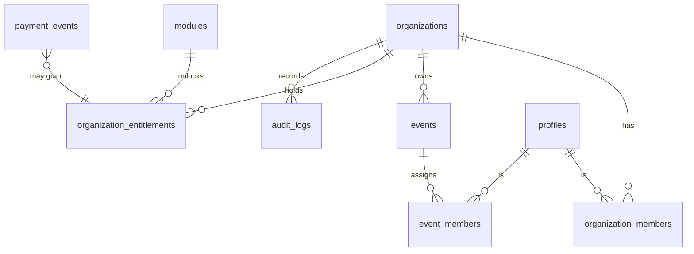

# Data Model — Foundation (v0.1)

Only foundation tables exist in migration `0001_foundation.sql`. Later-module tables are added by reviewed migrations when each module is built.

**Tenant boundary:** every tenant row carries `organization_id` (or reaches it through its event). Access is decided by database helper functions that read the signed-in user from the session, never from an ID sent by the browser.

**Deny by default:** row-level security is on for every table. `payment_events`, entitlements and the module catalog can only be written by the server using the service key.

| Table | Purpose |
|---|---|
| profiles | One per login user |
| organizations | A customer company workspace |
| organization_members | User + role + status per organization |
| events | Shared event record, with time zone |
| event_members | Who is assigned to which event |
| modules | Module catalog and release state |
| organization_entitlements | Which organization bought which module |
| payment_events | Stripe event IDs for duplicate protection |
| audit_logs | Who did what |
